# Read the code, inspect the evidence, reproduce the results

The repository contains two implemented synthetic studies and a separate SAE
proposal. Start with the code flow, then the scoring example, then the evidence
and audit checks. The diagrams describe information and calls; the measured
results live in the frozen run files.

| Goal | Start here |
|---|---|
| See what runs, what agents see, and where posts go | [Architecture and message-flow diagrams](architecture.md) |
| Trace a concrete task through calls and scoring | [Code walkthrough](code-walkthrough.md) |
| Check which methods have peer-reviewed support | [Code-to-research evidence map](../research/methods-evidence.md) |
| Inspect claim corrections and remaining limits | [Research and documentation audit](../research/claim-audit.md) |
| Reproduce historical artifacts | [Replay commands and verification scope](../handoffs/verification.md) |
| Rebuild the current report and check citations | [Current report verification](#current-report-verification) |



## Visual exports

The canonical editable sources are the four Mermaid fences in
[architecture.md](architecture.md). GitHub renders them inline. SVG exports use
those same fences, with accessible titles and descriptions:

- [Study entrypoints and artifact flow](diagrams/01-study-dataflow.svg)
- [v2 topology and call opportunities](diagrams/02-v2-topologies.svg)
- [Provenance publication boundary](diagrams/03-provenance-boundary.svg)
- [Proposed, unimplemented SAE path](diagrams/04-sae-proposal.svg)

To regenerate them, install the rendering tools in a separate directory. This
does not install model libraries or run an experiment:

```bash
PUPPETEER_SKIP_DOWNLOAD=true npm install --prefix /tmp/swarm-diagram-tools @mermaid-js/mermaid-cli@11.12.0 mermaid@11.17.2
python3 docs/guide/tools/render_diagrams.py --mmdc /tmp/swarm-diagram-tools/node_modules/.bin/mmdc --browser /usr/bin/chromium
```

Set `--browser` to your local Chromium executable, or omit it when Puppeteer's
configured browser is available. SVG appearance can vary with fonts and browser
versions; the Mermaid source defines the explanatory content. These illustrations
are not statistical outputs. The managed rendering environment used an HTTP
localhost copy of the renderer page because its browser blocks `file:` URLs;
no browser policy was disabled.

## Current report verification

These checks use the current scorer and report tools on the frozen raw data.
They complement the historical replays, which deliberately use their pinned
analysis revisions. Install dependencies before requesting offline execution.
From the repository root:

```bash
python3 report/tools/check_claims.py --quiet
python3 report/tools/render_refs.py report/draft.md --bib docs/research/references.bib --out report/references.md --check
uv run --no-project --with matplotlib==3.10.8 python report/figures/make_figures.py --out-dir /tmp/swarm-report-figures
cmp report/figures/figure-data.json /tmp/swarm-report-figures/figure-data.json
python3 docs/guide/tools/check_docs.py
```

The figure command cross-checks committed cell values and regenerates plots into
a separate directory. The JSON comparison checks plotted values, not image-byte
identity or every visual encoding. Keep the checked-in images under visual review.
The claim checker recomputes specified numeric claims and pins other numbers on
cited lines; it does not prove every sentence, verify external findings, or
establish a mechanism. Source checks and scoped interpretation remain necessary.

`mock` runs check plumbing. Archived inference replay checks recorded evidence.
Fresh hosted-model inference can change because the service and sampling are not
fully controlled. None of these checks constitutes independent scientific
replication across models, tasks, or providers.
