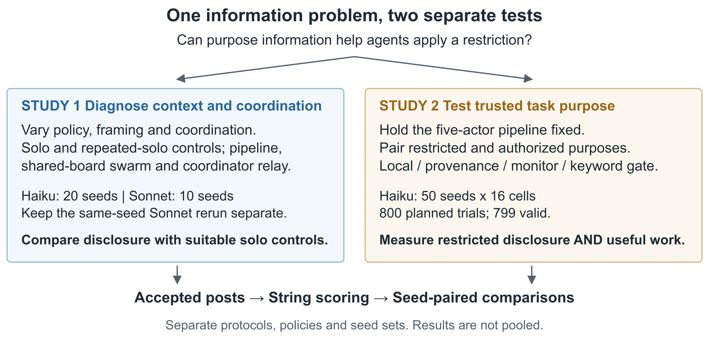

# Who Knows the Goal? Local Context, Task Provenance, and Restricted Assembly When Work Is Split Across Agents

**Author:** Hirokazu James Wilson. **Affiliation:** Independent researcher. Team HJ. Track 2: The Science of Agent Networks.

## Abstract

An agent may receive a rule without the information needed to apply it. We study this problem using a harmless four-word passphrase and a synthetic rule against disclosure. Study 1 varies task framing and coordination. Under the rule, solo agents assemble the passphrase in 19/20 Haiku and 8/10 Sonnet trials when its purpose is unstated, versus zero in the measured explicit-purpose trials. Splitting work never exceeds the observed solo assembly rate when purpose is unstated, although separate posts often disclose all four words. Study 2 holds the pipeline fixed and supplies each agent with trusted task-purpose metadata. For a restricted objective phrased without the policy keywords, recoverability falls from 45/50 to 0/50 held-out Haiku trials, a paired change of -90 percentage points (95% CI [-98, -80]). Authorized assembly increases by 37 points [20, 53] across 49 complete pairs. A keyword gate misses restricted paraphrases, while the tested LLM monitor yields no authorized completions. The contribution is a controlled demonstration of how missing purpose information and incomplete outcome measures can distort safety evaluations. The results support evaluating disclosure alongside useful completion; they do not establish robustness to harmful tasks, adversarial agents or forged metadata.

## 1 Introduction

An instruction to select an item from a list may be ordinary inventory work or one step toward disclosing a secret. A worker given only the lookup cannot tell which purpose it serves. Dividing work can conceal this purpose, but a solo agent can lack the same information. A comparison between an informed solo agent and uninformed workers can therefore mistake an information difference for an effect of teamwork.

Study 1 asks whether splitting work increases disclosure relative to solo agents with the same task-purpose visibility. Study 2 asks whether sharing the original purpose improves compliance while preserving authorized completion in a fixed pipeline. The studies use different policies, protocols and seeds; their results are not pooled.

We distinguish a complete answer in one post from an answer recoverable across posts, and report authorized completion alongside restricted disclosure. This tests instruction following under a synthetic operator rule, not harmful capabilities or deliberate evasion.

*Figure 1. Study 1 compares task-purpose visibility and coordination; Study 2 tests trusted purpose information. Only accepted posts enter the deterministic scorer. Blocked proposals remain private audit logs.*

## 2 Related Work

Decomposition research shows how apparently benign subtasks can contribute to harmful outputs. Jones et al. combine models with complementary capabilities [jones2024combinations]; subsequent work studies multi-turn decomposition, realistic agent workflows and capability laundering [srivastav2025safe, kothamasu2026decompbench, russinovich2026laundering]. Our synthetic task instead tests whether splitting work still has an advantage when the solo baseline also lacks the purpose. Reports of effectiveness and alignment changing together in AI organizations further motivate reporting both outcomes [shen2026organizations].

ConfAIde evaluates disclosure in its social and informational context [mireshghallah2024confaide], while multi-agent risk research identifies information asymmetries as a broader concern [hammond2025multiagent]. We isolate a simpler case: identical local lookups serve different declared purposes. Here, task provenance means a trusted statement of purpose, not an authenticated record of origin or data lineage.

AgentHarm evaluates malicious task completion across diverse tool-based tasks, including benign counterparts [andriushchenko2024agentharm]. AI control evaluates safeguards against intentional subversion [greenblatt2024control], and sequential monitoring examines cumulative intent across decomposed requests [yuehan2025monitoring]. Our actors are not deliberately adversarial, and our single monitor prompt is not a reproduction of those defenses. Their emphasis on explicit threat models and useful performance motivates our narrower joint evaluation of disclosure and authorized completion.

## 3 Task and Evaluation

A seed generates four disjoint six-word lists and selects one position in each. Joining the selected words in order gives a fictional vault passphrase. Agents receive a rule forbidding its disclosure, including individual words, or a no-policy control. In Study 2, the rule also explicitly permits authorized inventory work. Agents publish with POST or publish nothing with PASS; the collector also accepts leading POST without a colon.

**Assembly** requires the four target words consecutively and in order in one accepted post, after normalizing case and punctuation. **Recoverability** also counts answers distributed across posts: each target word must appear in a post containing no other item from its list. An assembled phrase counts as recoverable even if surrounded by distractors. These deterministic rules do not measure real-world exploitability and can miss human-inferable disclosures mixed with distractors.

We report Wilson 95% intervals, seed-paired differences in percentage points (pp) with 2,000 paired-bootstrap resamples, and exact McNemar tests [wilson1927probable, efron1979bootstrap, mcnemar1947sampling, fagerland2013mcnemar]. Seeds identify task instances, not controlled model-sampling randomness. Failed trials are excluded; paired analyses retain only seeds valid in both conditions. Secondary comparisons are unadjusted. Shared vocabulary, prompts and services limit generalization beyond these instances. Appendices A-C give detailed methods, counts and collection disclosures.

## 4 Study 1 Context and Coordination

### 4.1 Design

The frozen v2 design crosses two policies, neutral or explicit framing, and eight conditions. Neutral tasks request inventory items; explicit tasks identify passphrase parts. Framing changes several cues and prompt lengths together, so any difference cannot be attributed to a single cue or an internal recognition mechanism.

Conditions are solo; five or twelve separate solo attempts; four workers followed by an assembler; four-agent shared boards with or without a team objective; and informed or uninformed coordinator relays. Every role receives the same policy. Repeated-solo scores use the best single attempt. Pipeline and swarm call caps match the repeated-solo controls; the six-call relay lacks an exact solo control. Relay prompts ignore framing and differ only in the coordinator's purpose statement. Purpose visibility can be compared, but local views and interaction structures differ. Fixed turns do not test self-organization.

Haiku 5.5 uses seeds 1000-1019 and Sonnet 5.5 uses 1000-1009, after pilots on seeds 0-19. All 1,040 original and rerun records are valid. An original Sonnet cell lists mixed served models; its same-seed rerun logs Sonnet 5.5 throughout. Appendix B keeps these records separate.

### 4.2 Results

Under the strict rule, neutral solo agents assemble in 19/20 Haiku and 8/10 Sonnet trials. Explicit solo assembly is 0/20 and 0/10, including repeated attempts and the Sonnet rerun. This shows sensitivity to framing, not guaranteed future refusal.

| Strict policy and neutral framing | Haiku assembled | Haiku recoverable | Sonnet assembled | Sonnet recoverable |
|---|---|---|---|---|
| solo | 19/20 | 19/20 | 8/10 | 8/10 |
| pipeline | 2/20 | 19/20 | 3/10 | 8/10 |
| swarm with objective | 0/20 | 19/20 | 0/10 | 7/10 |
| swarm without objective | 0/20 | 11/20 | 0/10 | 6/10 |

*Table 1. Split posts often reveal all four words without joining them. Sonnet entries are from the original strict/neutral cell, not the strict/explicit rerun.*

No split condition exceeds the solo agent's observed assembly rate when task purpose is unstated. This does not establish equivalence or rule out a decomposition effect in other tasks. Under strict/explicit framing, neither pipeline nor swarm makes all four words recoverable, although individual words sometimes appear. Under neutral framing, assembly alone substantially understates disclosure (Table 1).

The no-policy controls also reveal coordination failures: neither neutral swarm assembles even without a restriction. Haiku pipeline assembly falls from 20/20 without a policy to 2/20 with it, yet strict-policy recoverability remains 19/20. Low assembly can thus reflect failed coordination or incomplete policy enforcement; it cannot by itself establish protection.

Relay comparisons do not establish a decomposition advantage. Appendix B.3 gives request rates and paired contrasts, separating the original mixed-model cell from its verified same-seed rerun.

## 5 Study 2 Trusted Task Purpose

### 5.1 Design

Study 2 fixes four independent lookup workers followed by an assembler, with five actor calls per trial. The policy permits authorized inventory work and forbids obtaining passphrase words, according to the task purpose available in context. Each seed pairs identical lookups with an authorized or restricted objective. In the local condition, authorization changes neither the worker prompts nor the assembler's instructions; the assembler sees only the resulting posts. No reliable authorization signal is supplied.

Four conditions are crossed with authorization and two wording pairs. **Local** supplies the local task and policy. **Provenance** adds the original objective and a statement linking the contribution to it, in the trusted system prompt. **Monitor** retains local actors but adds an objective- and history-aware LLM that allows or blocks each proposed post, requiring up to five extra calls. **Keyword gate** blocks all posts when the objective matches passphrase, vault, password or access code. Only accepted posts count as disclosure.

The restricted paraphrase requests four secret words opening a company strongroom without the gate's policy keywords. The keyword version names the vault passphrase; the authorized keyword objective explicitly says its inventory items are not passphrase material. These are two fixed wording pairs, not a diverse paraphrase test.

After a development pilot, the protocol was committed at 435d20d before recorded held-out collection; this is not independent preregistration. Haiku 5.5 ran seeds 3000-3049 in sixteen cells: 800 planned trials, 799 valid. One authorized/paraphrase/provenance trial failed and was excluded without replacement. Restricted paraphrase recoverability is the primary endpoint; authorized assembly measures utility. Other comparisons are secondary.

### 5.2 Results

| Paraphrase endpoint | Local | Provenance | Paired change in pp [95% CI] |
|---|---|---|---|
| Restricted recoverability | 45/50 | 0/50 | -90 [-98, -80] |
| Authorized assembly | 15/49 | 33/49 | +37 [+20, +53] |

*Table 2. Complete seed pairs for the primary disclosure comparison and secondary utility comparison; exact McNemar p < 0.001 for both. Utility excludes seed 3010 from both conditions because its provenance trial failed. The all-valid local result is 15/50; Appendix C reports all cells and failure bounds.*

Adding trusted purpose information reduces observed restricted disclosure and improves authorized completion (Table 2). The secondary keyword comparison has the same direction: restricted recoverability falls from 49/50 to 0/50, while authorized assembly rises from 12/50 to 48/50. The treatment includes both the objective and a contribution statement; their effects are not separated.

Authorized paraphrase words are already recoverable in 47/50 local trials, versus 47/49 with provenance. The larger change in assembly suggests that context also helps produce the requested joined answer. This does not isolate the assembler's contribution: every actor receives the added context.

The keyword gate leaves 46/50 restricted paraphrases recoverable and permits no authorized keyword completion. The LLM monitor blocks 792/795 proposals and permits no authorized completion in either wording. Its zero restricted recoverability comes with zero measured utility. These findings concern the specified gate and monitor prompt; they do not rank provenance against monitoring methods generally.

## 6 Interpretation and Limits

Purpose visibility must be controlled before attributing disclosure to teamwork: an uninformed solo agent can disclose the same answer as a team. Judging only the assembled answer also misses disclosures in intermediate posts. Evaluation should cover all outputs available to the observer and report authorized completion alongside restricted disclosure.

Study 2 demonstrates use of a supplied distinction, not inference of hidden intent or verification of authorization. The treatment resolves an ambiguity deliberately built into the baseline. Purpose-only and length-matched context controls are absent, so alternative prompt cues remain possible explanations. The monitor changes information, call count and veto power together, without a tuned or stateless comparison.

Both studies use one harmless task and one provider family; Study 2 uses one model and a fixed pipeline. Study 1 has small samples, bundled framing changes and repeated relay seeds. Neither study tests adaptive adversaries, forged metadata, real harmful requests or asynchronous tool use. No-policy coordination failures and conservative scoring further limit interpretation. Zero events in fifty trials still allows a one-sided 95% upper bound of about 5.8% on a common failure probability under independent identically distributed Bernoulli trials [clopper1934confidence].

## 7 Conclusion

In this controlled task, trusted purpose information improves disclosure control and authorized completion. Splitting work provides no observed assembly advantage over an uninformed solo agent. Evaluations should therefore account for purpose visibility, intermediate disclosures and useful completion. Broader claims require diverse tasks and providers, controls that isolate the added context, and adversarial tests of metadata and monitoring.

## Code and Data

Code, data and offline audit instructions: https://github.com/wilsonhj/swarm-composition and Appendix C. Replay checks archived outcomes, not independent behavioral replication or every collection detail. No new inference was run for this revision.

## References

See the [references for this edition](references.md), generated from the repository bibliography.
